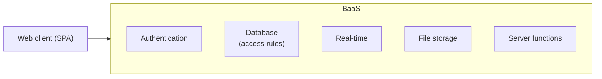

<!-- Language: **English** · [Русский](README.ru.md) -->

# Azimut

Internal task-management system with role-based workflow, deadline control, and process analytics.

## Purpose

A corporate task-management system built for a single department rather than a whole company. A manager assigns work and tracks how it progresses; an employee runs their own queue and moves tasks through their statuses. It covers the parts that generic trackers leave out: a clear split of responsibilities between manager and employee, active deadline control, and analytics on the work process itself — not just a list of cards.

## Who it's for

An internal tool for one organization, not a public service. Access is by invitation only and open sign-up is disabled. There are three roles:

- **Administrator** — runs the system and its users.
- **Manager** — plans work and oversees the team.
- **Employee** — carries out assigned tasks.

## Roles and capabilities

| Role | What they do |
| --- | --- |
| **Administrator** | Manage users and invitations · assign and change roles · review the access audit trail |
| **Manager** | Create tasks and set deadlines · assign owners and balance the team's workload · read process analytics · export reports |
| **Employee** | Work a personal queue prioritized by deadline · change task status · leave comments and attach files |

## Key features

- Kanban board with configurable statuses
- Deadline control with color-coded urgency
- Rework tracking — tasks sent back for revision are counted, not hidden
- Process analytics that surface where work stalls
- Real-time view of each employee's current workload
- Notifications and live updates across sessions
- Report export
- Access rules enforced at the database level

## Architecture

The client is a single-page app; everything behind it runs on a managed backend platform. Business logic and access rules live in the database itself, so permissions are enforced on the server and the client can't bypass them — it only ever sees the data a given role is allowed to see. Privileged operations run through server-side functions rather than trusting the browser.

## Stack

| Layer | Technology |
| --- | --- |
| Frontend | React 19 + Vite |
| Styling | Tailwind CSS v4 |
| Routing & state | React Router, React hooks |
| Charts | Recharts |
| Drag & drop | dnd kit |
| Backend | Supabase (managed platform) |
| Database | PostgreSQL |
| Authentication | Supabase Auth |
| Hosting | Static frontend + managed backend |

## Status

Working prototype under active development.
