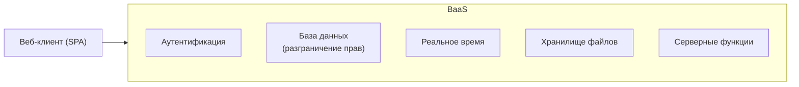

<!-- Язык: [English](README.md) · **Русский** -->

# TaskFlow

Внутренняя система управления задачами: разделение ролей, контроль сроков и аналитика процесса.

## Назначение

Корпоративная система управления задачами для отдельного подразделения, а не для всей компании. Руководитель ставит задачи и следит за их исполнением, сотрудник ведёт собственную очередь и переводит задачи между статусами. Система закрывает то, чего не хватает в универсальных трекерах: чёткое разделение ответственности между руководителем и сотрудником, живой контроль сроков и аналитику самого рабочего процесса, а не просто список карточек.

## Для кого

Внутренний инструмент одной организации, а не публичный сервис. Доступ только по приглашению, открытая регистрация отключена. Предусмотрены три роли:

- **Администратор** — отвечает за систему и её пользователей.
- **Руководитель** — планирует работу и следит за командой.
- **Сотрудник** — выполняет поставленные задачи.

## Роли и возможности

| Роль | Что делает |
| --- | --- |
| **Администратор** | Управляет пользователями и приглашениями · назначает и меняет роли · просматривает журнал доступа |
| **Руководитель** | Ставит задачи и назначает сроки · распределяет исполнителей и балансирует загрузку команды · смотрит аналитику процесса · выгружает отчёты |
| **Сотрудник** | Ведёт личную очередь задач с приоритетом по срокам · меняет статус · оставляет комментарии и прикрепляет файлы |

## Ключевые возможности

- Канбан-доска с настраиваемыми статусами
- Контроль сроков с цветовой индикацией срочности
- Учёт возвратов на доработку — они считаются, а не теряются
- Аналитика узких мест: видно, где работа застревает
- Загрузка каждого сотрудника в реальном времени
- Уведомления и живое обновление между сессиями
- Экспорт отчётов
- Разграничение прав на уровне базы данных

## Архитектура

Клиент — одностраничное приложение, а всё за ним работает на управляемой бэкенд-платформе. Бизнес-логика и права доступа реализованы на уровне самой базы данных: разграничение действует на сервере, и клиент не может его обойти — он видит только те данные, которые разрешены его роли. Привилегированные операции выполняются серверными функциями, а не доверяются браузеру.

## Стек

| Слой | Технология |
| --- | --- |
| Frontend | React 19 + Vite |
| Стилизация | Tailwind CSS v4 |
| Роутинг и состояние | React Router, React-хуки |
| Графики | Recharts |
| Drag & drop | dnd kit |
| Backend | Supabase (управляемая платформа) |
| База данных | PostgreSQL |
| Аутентификация | Supabase Auth |
| Хостинг | Статический фронтенд + управляемый бэкенд |

## Статус

Рабочий прототип в активной разработке.
